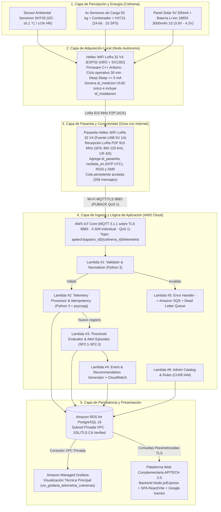

# Arquitectura General del Sistema — APITECH 2.0

## 1. Arquitectura de Cinco Capas (Referencia Sección 3.7 del Documento Técnico PDF)

**APITECH 2.0** implementa las cinco capas de responsabilidad definidas en la Figura 13 (páginas 31–32) del documento técnico `Eva4ApiTechJorimCaroAndresDiaz.pdf`, complementadas por la plataforma web interactiva y el asistente de inteligencia artificial:

---

## 2. Procesos de Negocio Soportados (Sección 3.1 BPMN del PDF)

### a) Monitoreo periódico de la colmena (Cada 30 minutos en operación física / 4 segundos en modo demo)
- **SP1.1. Adquirir y preparar las variables**: El nodo Heltec V4 despierta del *Deep Sleep*, energiza los sensores (`PIN_VEXT_CTRL`), lee temperatura y humedad del SHT45, peso calibrado del HX711 y tensión de batería (`bateria_v`), valida las lecturas y asigna un `id_medicion` (UUID v4).
- **SP1.2. Transportar la medición**: El nodo transmite la trama por LoRa P2P en 915 MHz hacia la pasarela central (hasta 3 intentos inmediatos conservando el mismo `id_medicion`). La pasarela envía el ACK LoRa, incorpora `id_pasarela`, `recibida_en` (UTC vía NTP), `rssi_dbm` y `snr_db`, y publica por MQTT 3.1.1 sobre TLS hacia AWS IoT Core con QoS 1. Si no hay Internet, conserva el mensaje en su cola persistente acotada.
- **SP1.3. Validar y almacenar**: AWS IoT Core invoca el pipeline AWS Lambda. `lambda_validator_normalizer` verifica el esquema y el topic; `lambda_telemetry_processor` controla duplicados mediante `id_medicion` e inserta únicamente registros nuevos en PostgreSQL.

### b) Evaluación y gestión de alertas
- **SP2.1. Evaluar las reglas de la colmena**: `lambda_threshold_evaluator` recupera las reglas activas de `configuracion_umbral` y calcula la variación de peso respecto a una lectura comparable de la misma instalación. Los mensajes duplicados o lecturas históricas atrasadas reenviadas desde la cola de la pasarela no sobrescriben el estado actual ni disparan falsas alertas (`CP09`).
- **SP2.2. Abrir o actualizar una alerta**: Si se supera un límite, se abre un episodio en `alerta` (`id_medicion_inicio`) o se actualiza el episodio activo existente (`id_medicion_ultima`, `ocurrencias + 1`), garantizando como máximo una alerta activa por regla/colmena.
- **SP2.3. Registrar la recuperación**: Cuando la variable regresa al intervalo permitido, la Lambda cierra automáticamente la alerta activa (`estado = 'RESUELTA'`, `resuelta_en = CURRENT_TIMESTAMP`, `resuelta_por_sistema = TRUE`), conservando su historial.

### c) Consulta y priorización de inspecciones
- **SP3.1 – SP3.3**: El apicultor consulta los paneles técnicos en **Amazon Managed Grafana** y en la **Plataforma Web APITECH 2.0**, examina tendencias históricas, alertas vigentes y recomendaciones contextualizadas por periodo apícola, y decide fundamentadamente si corresponde realizar una inspección presencial en terreno.
