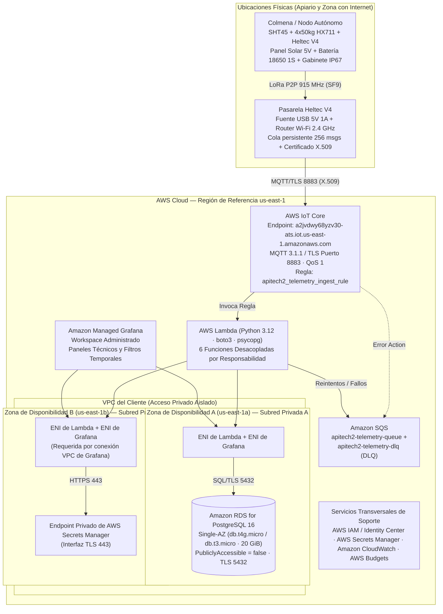

# Arquitectura Nativa en Amazon Web Services (AWS) — APITECH 2.0

## 1. Diseño de Infraestructura en `us-east-1` (Referencia Sección 3.6 del PDF)

La arquitectura cloud de **APITECH 2.0** replica fielmente la **Figura 12 (Diseño de Infraestructura, páginas 29–30)** del documento técnico original `Eva4ApiTechJorimCaroAndresDiaz.pdf`:

---

## 2. Responsabilidades de los 10 Servicios AWS Obligatorios

### 2.1. AWS IoT Core (`aws/iot-core/`)
- **Endpoint verificado en la cuenta**: `a2jvdwy68yzv30-ats.iot.us-east-1.amazonaws.com`.
- **Protocolo y Seguridad**: MQTT 3.1.1 sobre TLS 1.2/1.3 (puerto TCP `8883`), QoS 1 y certificados X.509 individuales por dispositivo (`iot_policy_per_device.json`). Se prohíbe el uso de una credencial compartida para todos los nodos.
- **Convención de Topics**: `apitech/{apiario_id}/{colmena_id}/telemetria`.
- **Thing Registry (`thing_registry_template.json`)**: Define los tipos `ApiTech2HeltecV4Gateway` (4 pasarelas) y `ApiTech2HeltecV4Node` (12 nodos), cada uno con su `thingName` único.
- **Regla IoT (`topic_rules.json`)**: `SELECT *, topic() AS topic_mqtt, topic(2) AS topic_apiario_id, topic(3) AS topic_colmena_id FROM 'apitech/+/+/telemetria'` con acción principal hacia AWS Lambda y `errorAction` hacia Amazon SQS (`apitech2-telemetry-dlq`).

### 2.2. AWS Lambda en Python 3 (`aws/lambdas/`)
Siguiendo el principio de responsabilidad única (Sección 4.2 del Prompt Maestro), la lógica se divide en **6 funciones independientes**:
1. **`lambda_validator_normalizer`**: Valida estructura JSON, convención de topic MQTT, formato UUID de `id_medicion`, rangos físicos de SHT45/HX711/Batería/LoRa y normaliza marcas temporales UTC (`capturada_en`, `recibida_en`, `ingresada_en`).
2. **`lambda_telemetry_processor`**: Conecta a PostgreSQL mediante `psycopg` con SSL/TLS, verifica **idempotencia** por `id_medicion` (ignorando duplicados de QoS 1 sin reinsertar), detecta lecturas antiguas reenviadas (`is_historical_replay`) y persiste transaccionalmente la medición.
3. **`lambda_threshold_evaluator`**: Ejecuta los subprocesos BPMN `SP2.1`, `SP2.2` y `SP2.3`: evalúa reglas activas, abre o actualiza episodios de alerta deduplicados (`id_medicion_inicio`, `id_medicion_ultima`, `ocurrencias`) y resuelve automáticamente la alerta cuando la variable vuelve al rango normal.
4. **`lambda_event_generator`**: Genera recomendaciones operativas contextualizadas por `periodo_apicola`, escribe auditoría en `registro_evento` y publica métricas en Amazon CloudWatch (`boto3`).
5. **`lambda_error_handler`**: Gestiona errores de validación o persistencia, controla el número de intentos (`maxReceiveCount = 3`) y deriva mensajes fallidos a Amazon SQS / Dead Letter Queue (`apitech2-telemetry-dlq`).
6. **`lambda_admin_catalog`**: Implementa el caso de uso `CU09` del PDF para mantener catálogos, asignar instalaciones (`instalacion`) sin solapamiento temporal y validar límites de reglas de alerta.

### 2.3. Amazon RDS for PostgreSQL (`database/migrations/`)
- Instancia relacional privada (`PubliclyAccessible = false`), `db.t4g.micro` o `db.t3.micro` Single-AZ con 20 GiB gp3, respaldos automáticos diarios con retención de 7 días (`RPO ≤ 24 horas`, `RTO ≤ 8 horas`).
- Conexión cifrada obligatoria con validación de certificado CA (`global-bundle.pem`, `sslmode=verify-full` en Python y `rejectUnauthorized: true` en Node.js).

### 2.4. Amazon Managed Grafana (`aws/grafana/apitech2_grafana_dashboard.json`)
- Herramienta principal de visualización técnica en la arquitectura AWS.
- Dado que RDS permanece privado dentro de la VPC, Amazon Managed Grafana requiere configurar una **Conexión VPC de Salida (Outbound VPC Connection)** con interfaces de red (ENI) en al menos **dos subredes privadas en distintas Zonas de Disponibilidad (`us-east-1a` y `us-east-1b`)**, tal como se documenta en la página 30 del PDF.
- Nota arquitectónica importante del PDF: distribuir las ENIs de Grafana en dos AZs es un requisito de red del servicio administrado y **no convierte la instancia RDS Single-AZ en una base Multi-AZ**.

### 2.5. Amazon SQS y Dead Letter Queue (`aws/sqs/sqs_queues_config.json`)
- Justificación funcional: Desacoplar la ingesta MQTT de los fallos transitorios de procesamiento o base de datos, evitando la pérdida de telemetría cuando ocurre un pico de reenvíos desde la cola de una pasarela tras recuperar Internet.
- Configuración: Cola principal `apitech2-telemetry-queue` (`VisibilityTimeout = 30s`) vinculada con `RedrivePolicy` (`maxReceiveCount = 3`) hacia la Dead Letter Queue `apitech2-telemetry-dlq` (retención 14 días) y alarma CloudWatch ante cualquier mensaje visible en DLQ.

### 2.6. Amazon CloudWatch (`aws/cloudwatch/dashboard_and_alarms.json`)
- Recopila logs JSON estructurados de las 6 funciones Lambda (con sanitización automática de secretos), métricas nativas (`Invocations`, `Errors`, `Duration p95`, `ApproximateNumberOfMessagesVisible`, `DatabaseConnections`) y métricas de negocio en el namespace `ApiTech2/Telemetry`.

### 2.7. AWS IAM (`aws/iam/least_privilege_policies.json`)
- Separa estrictamente 5 políticas de mínimo privilegio: (1) Dispositivos IoT X.509, (2) Ejecución de Lambdas de telemetría, (3) Almacenamiento y secretos, (4) Backend de aplicación web, y (5) Administración técnica (`CU09`).

### 2.8. AWS Secrets Manager (`aws/lambdas/common/db_client.py`)
- Gestiona el secreto `apitech2/production/rds-postgres` accedido vía VPC Interface Endpoint privado. Cuando el entorno AWS Academy restringe Secrets Manager, el cliente activa de forma documentada un fallback seguro a variables de entorno sin exponer credenciales en código ni logs.

### 2.9. Amazon VPC y Security Groups (`aws/vpc/vpc_network_architecture.json`)
- Aísla la base de datos en `SG-ApiTech2-RDS`, aceptando tráfico TCP `5432` exclusivamente desde `SG-ApiTech2-Lambda`, `SG-ApiTech2-Grafana` y `SG-ApiTech2-WebApp`.

### 2.10. AWS Budgets (`aws/cloudwatch/dashboard_and_alarms.json`)
- Define el presupuesto mensual `ApiTech2-Monthly-Cloud-Budget` alineado con la reserva de planificación del documento técnico PDF (**\$58.356 CLP mensuales** ≈ \$60 USD), con alertas preventivas al alcanzar el 80% del umbral.
