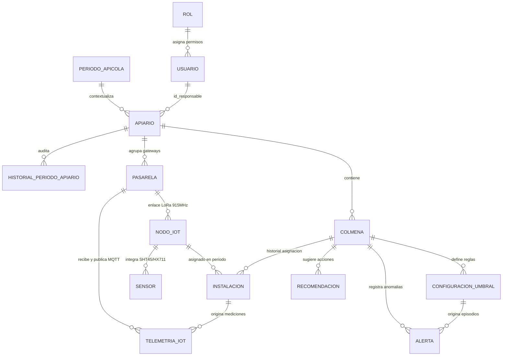

# Modelo de Datos Relacional en PostgreSQL — APITECH 2.0

## 1. Diseño Normalizado y Alineación con el Documento Técnico PDF

El modelo relacional de **APITECH 2.0** (`database/migrations/001_schema_apitech2.sql`) integra la totalidad de las entidades y restricciones del **Anexo A (Diccionario de Datos, páginas 25–36)** del documento `Eva4ApiTechJorimCaroAndresDiaz.pdf` junto con las entidades requeridas en la **Sección 7 del Prompt Maestro**:

- **Separación entre `nodo_iot`, `colmena`, `pasarela` e `instalacion`**: Permite conservar el origen histórico exacto de las mediciones cuando un nodo físico Heltec V4 se reemplaza, recalibra o traslada a otra colmena, impidiendo periodos de instalación solapados mediante índices únicos parciales (`WHERE hasta IS NULL`).
- **Idempotencia nativa mediante `id_medicion` (`UUID UNIQUE`)**: Se genera en el nodo de adquisición y se conserva durante los reintentos LoRa y las entregas repetidas de MQTT QoS 1, evitando insertar mediciones duplicadas.
- **Triple trazabilidad temporal en UTC**: Cada registro en `telemetria_iot` distingue `capturada_en` (nodo), `recibida_en` (pasarela vía NTP) e `ingresada_en` (inserción por Lambda en la nube).
- **Independencia total**: No utiliza ninguna tabla ni lógica del proyecto `COFRIAL` ni comparte la base de datos de `APITECH` (opera sobre `apitech2_db`).

---

## 2. Diagrama Entidad-Relación (`apitech2_db`)



---

## 3. Catálogo de las 16 Tablas Implementadas

| # | Tabla | Clave Primaria | Claves Foráneas / Unicidad | Propósito en APITECH 2.0 |
|---|---|---|---|---|
| 1 | `rol` | `rol_id` | `UNIQUE(codigo)` | Roles de mínimo privilegio (`ADMIN`, `APICULTOR`, `TECNICO`, `GRAFANA_READONLY`). |
| 2 | `usuario` | `usuario_id` | `FK rol_id`, `UNIQUE(identidad_externa, correo)` | Usuarios y vínculo con IAM Identity Center (`Anexo A.1 PDF`). |
| 3 | `periodo_apicola` | `periodo_id` | `UNIQUE(codigo)` | `COSECHA_MIEL`, `INVERNADA`, `POLINIZACION` con rangos térmicos/hídricos de referencia. |
| 4 | `apiario` | `apiario_id` | `FK id_responsable`, `FK periodo_apicola_id` | Agrupa colmenas y pasarelas bajo un responsable (`Anexo A.2 PDF`). |
| 5 | `historial_periodo_apiario` | `historial_id` | `FK apiario_id`, `FK periodo_apicola_id` | Trazabilidad histórica de cambios manuales de periodo apícola. |
| 6 | `pasarela` | `pasarela_id` | `FK apiario_id`, `UNIQUE(codigo, iot_thing_name)` | Equipos receptores Heltec V4 (LoRa 915 MHz -> Wi-Fi MQTT/TLS) y estado de cola persistente (`Anexo A.4 PDF`). |
| 7 | `colmena` | `colmena_id` | `FK apiario_id`, `UNIQUE(apiario_id, codigo)` | Unidades monitoreadas, fecha de alta y estado operativo (`Anexo A.3 PDF`). |
| 8 | `nodo_iot` | `nodo_id` | `FK colmena_id`, `FK pasarela_id`, `UNIQUE(codigo, iot_thing_name)` | Nodos Heltec V4 con identidad X.509 propia, consumo en reposo (mA), tensión `bateria_actual_v`, `rssi_actual_dbm` y `snr_actual_db` (`Anexo A.5 PDF`). |
| 9 | `instalacion` | `instalacion_id` | `FK nodo_id`, `FK colmena_id`, `UNIQUE(id_instalacion_uuid)` | Relaciona un nodo con una colmena en un periodo `[desde, hasta]` sin solapamientos y guarda el factor de calibración HX711 (`Anexo A.6 PDF`). |
| 10 | `sensor` | `sensor_id` | `FK nodo_id`, `UNIQUE(nodo_id, tipo_sensor)` | Sensores físicos por nodo (`SHT45` Temp/Humedad I2C, `HX711` 4x50kg, `ADC` Batería 1S, `SX1262` LoRa 915 MHz). |
| 11 | `telemetria_iot` | `telemetria_id` | `UNIQUE(id_medicion UUID)`, `FK instalacion_id, pasarela_id, apiario_id, colmena_id, nodo_id` | Mediciones históricas con `capturada_en`, `recibida_en`, `ingresada_en`, `temperatura`, `humedad`, `peso_kg`, `bateria_v`, `bateria_pct`, `rssi_dbm`, `snr_db`, `topic_mqtt` y `modo_frecuencia` (`Anexo A.7 PDF`). |
| 12 | `configuracion_umbral` | `umbral_id` | `FK apiario_id`, `FK colmena_id` | Reglas de alerta (`Anexo A.8 REGLA_ALERTA`) con validación de límites inferior < superior. |
| 13 | `alerta` | `alerta_id` | `FK umbral_id, apiario_id, colmena_id, nodo_id` | Episodios de alerta con `id_medicion_inicio`, `id_medicion_ultima`, deduplicación por `dedup_key` y cierre automático (`Anexo A.9 PDF`). |
| 14 | `recomendacion` | `recomendacion_id` | `FK apiario_id, colmena_id, periodo_apicola_id, alerta_id` | Sugerencias operativas basadas en reglas y respaldadas en `mediciones_soporte JSONB`. |
| 15 | `registro_evento` | `evento_id` | `FK apiario_id, colmena_id, nodo_id` | Bitácora estructurada de ejecuciones Lambda, rechazos de idempotencia, eventos IoT Core y auditoría. |
| 16 | `cola_mensajes_sqs` | `sqs_message_id` | `CHECK(cola_nombre)` | Persistencia de mensajes encolados y derivados a `apitech2-telemetry-dlq` (Dead Letter Queue). |

---

## 4. Índices de Alto Rendimiento (Sección 7 del Prompt Maestro)

```sql
-- Índices obligatorios por Apiario, Colmena, Nodo, Fecha, Tipo de medición e Instalación
CREATE INDEX idx_telemetria_apiario_fecha ON telemetria_iot(apiario_id, fecha_captura DESC);
CREATE INDEX idx_telemetria_colmena_fecha ON telemetria_iot(colmena_id, fecha_captura DESC);
CREATE INDEX idx_telemetria_nodo_fecha    ON telemetria_iot(nodo_id, fecha_captura DESC);
CREATE INDEX idx_telemetria_fecha_desc    ON telemetria_iot(fecha_captura DESC);
CREATE INDEX idx_telemetria_tipo_medicion ON telemetria_iot(tipo_medicion, fecha_captura DESC);
CREATE INDEX idx_telemetria_instalacion   ON telemetria_iot(instalacion_id, recibida_en DESC);

-- Restricción de no solapamiento de instalaciones vigentes (Anexo A.6 PDF)
CREATE UNIQUE INDEX idx_instalacion_nodo_vigente    ON instalacion(nodo_id) WHERE hasta IS NULL;
CREATE UNIQUE INDEX idx_instalacion_colmena_vigente ON instalacion(colmena_id) WHERE hasta IS NULL;

-- Deduplicación estricta: máximo una alerta activa por regla/colmena (Anexo A.9 PDF)
CREATE UNIQUE INDEX idx_alerta2_dedup_abierta ON alerta(dedup_key) WHERE estado IN ('ACTIVA', 'REVISADA');
```

---

## 5. Vistas SQL para Amazon Managed Grafana y Evaluación de KPIs SMART

En `database/migrations/002_politica_retencion_y_auditoria.sql` se definen dos vistas especializadas:
1. **`vw_grafana_telemetria_colmenas`**: Expone la columna temporal `"time"`, latencia de transporte (`ingresada_en - recibida_en`), códigos de apiario/colmena/nodo/pasarela, topic MQTT y todas las variables físicas para consulta directa desde **Amazon Managed Grafana**.
2. **`vw_kpis_documento_pdf`**: Calcula en tiempo real los indicadores de integridad (`KPI 6 ≥ 98%`), consumo en reposo (`KPI 2 ≤ 5 mA`), disponibilidad (`KPI 3 ≥ 95%`), estabilidad LoRa (`KPI 1 ≥ 95%`) y autonomía energética (`KPI 7 ≥ 72 h`).
